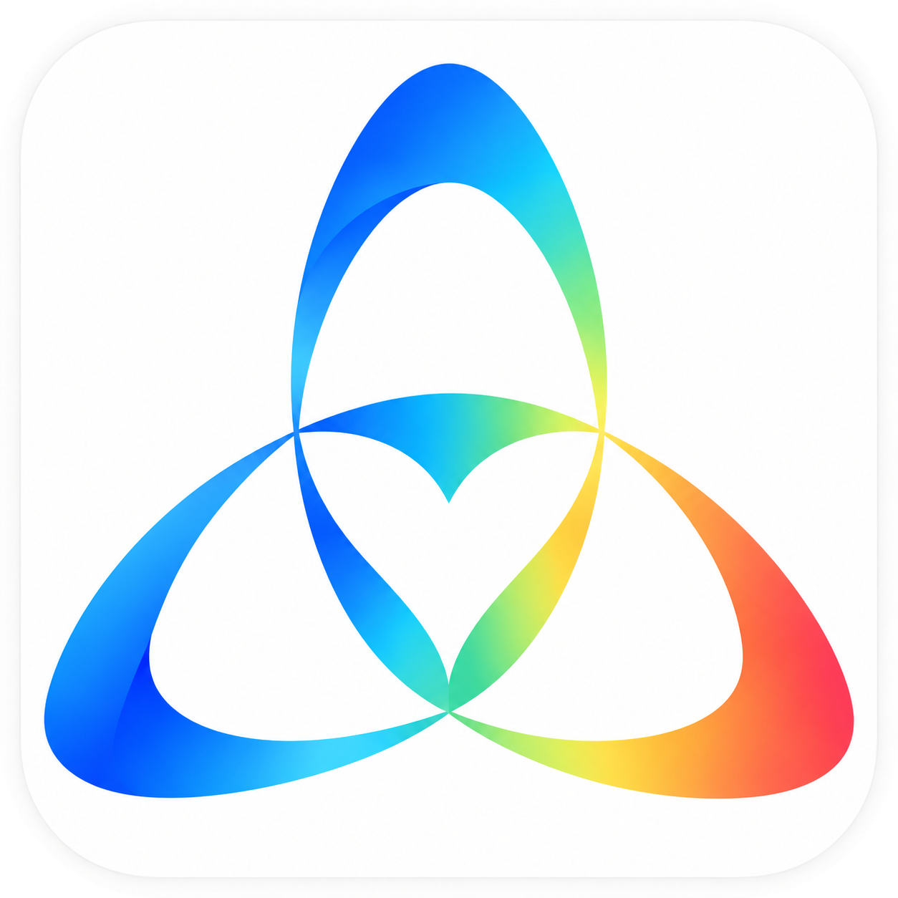

# Open QQ Dot

**A local Windows Dot companion that interfaces with multiple LLM backends and imitates diverse conversational styles.**

Open QQ Dot embeds an AI companion into your daily QQ conversations: remembering dialogue history, speaking in your configured voice, and performing file and command operations on your local PC upon explicit authorization.

You choose the model backends, configure independent personas, memories, and permissions for each friend, and manage everything through the desktop native interface or the mobile web dashboard.

This is an independent open-source project following the "Dot" personal assistant paradigm, with no official affiliation with OpenAI.

---

## 1. Local Work Environment

Open QQ Dot runs directly on your Windows PC. Dialogue histories, memories, style templates, and task files reside locally; host tools execute directly on this computer, eliminating the need for separate cloud infrastructure.

Local deployment does not mean you are forced to run heavy local LLMs. You can route inference to cloud models via CLIs (Codex CLI, Claude CLI, Antigravity CLI) or APIs, or integrate local inference engines on demand. When using cloud models, the prompt context required for generation is sent to your selected provider.

Message processing and autonomous tasks continue as long as your computer and the bridge are running; tasks do not persist on external servers once the local machine is powered down.

---

## 2. Flexible Model Integration

Dedicated configuration panels are provided for Codex CLI, Claude CLI, Antigravity CLI, and universal REST APIs.

The API interface supports standard OpenAI Chat Completions, OpenAI Responses, and Anthropic Messages formats, permitting multiple endpoints, model identifiers, and API keys.

Service endpoints are organized into three primary categories:

| Category | Purpose |
|---|---|
| **Model API** | Conversational chat, synthesis, and reasoning tasks |
| **Retrieval API** | Text embeddings, vector memory retrieval, and candidate reranking |
| **Tool API** | External HTTP web services integrated as assistant tools |

Each service maintains its own account credentials and keys. Models can be swapped dynamically while retaining friend memory stores and persona configurations.

---

## 3. Customizable Conversational Styles

Conversational style can be tailored per friend: concise and direct, warm and empathetic, casual colloquial, or custom persona prompts.

Beyond manual persona prompts, style templates can be extracted and trained from chat export files. Templates combine message length distributions, pacing, particles, emojis, laughter expressions, and catchphrases to shape subsequent generation.

For example, when responding to "I had such a tiring day today":

| Style | Illustrative Response Example |
|---|---|
| **Concise & Direct** | Take a rest now. We can handle the remaining work tomorrow. |
| **Warm & Attentive** | Were you busy all day? Sit down, relax, and grab a glass of water. |
| **Casual & Energetic** | Time to lie down! Your battery must be at zero percent haha. |

Templates can be synthesized, imported, exported, and bound to specific friends. Proactive greeting prompts can be configured individually.

---

## 4. Comprehensive Features

Open QQ Dot includes:
- Long-term memory extraction and semantic retrieval
- Friend preference notes and topical knowledge stores
- Dialogue histories and emotion tracking
- Custom emoji and sticker collections
- Proactive engagement, scheduled care, and conversation continuations

Each friend operates within an isolated context and permissions boundary, managed via the desktop GUI or the mobile House Web UI.

---

## 5. Granular Tool Authorization

Each friend features an independent "Local Workspace" toggle (disabled by default). When enabled, the assistant can read, write, and list text files within that friend's dedicated workspace directory (`workspaces/<QQ>/`) and launch URLs in the default browser.

Executing terminal commands requires an additional explicit permission toggle. Commands run under the current Windows user privileges; workspace paths do not constitute a kernel-level OS sandbox.

For full feature scope and desktop automation roadmap, see [Feature Matrix](docs/dot_feature_matrix.md).

---

## 6. Lightweight Footprint & Optional Local Models

The base release bundles no model weights and downloads none automatically. Default message classification and retrieval rely on rule heuristics, keyword indexing, and BM25 scoring. For enhanced semantic precision, configure a cloud embedding API or download local quantized models.

You do not need heavy local GPUs to run the full chat and management experience.

---

## 7. Summary

> Open QQ Dot is a locally deployed Dot-style AI companion. Accessible through QQ, it interfaces with diverse LLM providers, mimics customizable conversational styles, maintains persistent memories and proactive interactions, and provides desktop and mobile dashboards. When authorized, it executes local file and terminal tasks.

---

## 8. Documentation Index

- Setup & Configuration: [README.md](README.md)
- Contributor Guide: [AGENTS.md](AGENTS.md)
- Local Inference: [docs/model_recommendations_and_fallbacks.md](docs/model_recommendations_and_fallbacks.md)
- Tools & Sandbox Permissions: [docs/tools_and_permissions.md](docs/tools_and_permissions.md)

Code is licensed under the GNU General Public License v3.0 or later (GPL-3.0-or-later); third-party libraries and assets adhere to their respective licenses.

### Provider-neutral local Agent interoperability (2026-10-24)

The persistent Agent mailbox now supports both MCP sessions and a loopback-only authenticated
HTTP/JSON adapter with a small Python SDK. Agents are not limited to Claude Code or Codex: an
operator-provisioned external CLI, editor extension or custom Agent can participate without
assuming any unsupported vendor API. See `docs/UNIVERSAL_AGENT_INTEROP.md` for security, session
presence, structured handoffs, caveats and tests. Remote federation and direct integration with
third-party proprietary IDE sessions are **not** implemented.
