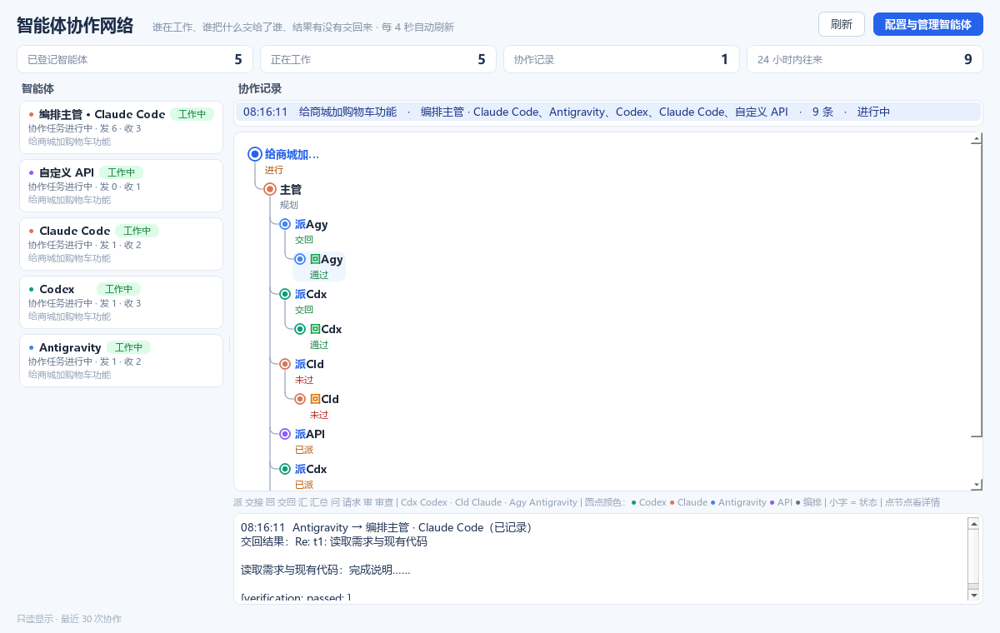

# 智能体协作：谁在工作、谁把什么交给了谁（2026-10-26）

## 之前

原来「智能体与工具 → 协作网络」只有四个计数和一张智能体名单，看不到它们之间做了什么。真实协作其实都有记录：多智能体任务由 `agent_messaging.Collaboration` 把每次分派、交回、汇总写进智能体邮箱（`data/agent_mail.sqlite3`，一次任务一个线程），只是界面没有读出来。

## 现在

**电脑**：左侧栏新增「智能体协作」（在「智能体与工具」下面），页面是 `house_qt/collaboration.py`，每 4 秒自动刷新，数据没变时不重画（不打断滚动和选中）。

- **顶部**：已登记智能体、正在工作、协作记录、24 小时内往来。
- **左侧智能体列表**：每个智能体一张卡片。
  - 圆点颜色代表背后的模型：Codex 绿、Claude 橙、Antigravity 蓝、API 紫、编排灰。
  - 状态：工作中 / 待处理 / 空闲，并说明原因，例如「协作任务进行中」「有在线会话」「2 条消息待处理」「协作已结束（任务已完成）」。
  - 发出与收到的条数，所属任务。
  - 点卡片跳到它最近一次协作。
- **右侧协作记录**：每次协作一行，写明时间、任务、参与者、条数和任务状态。选中后下方画出**竖排节点树**（按主人给的参考图：圆点 + 标题 + 小字，没有方框；一行一个节点，子节点向右缩进，用带圆角的连接线接到父节点；智能体再多也只往下长，可以滚动）：
  - **任务**（蓝色大圆点）
  - └ **主管**：编排主管，圆点用实际负责规划和汇总的模型的颜色
  - 　├ **派Cdx**：交接给某个智能体（Codex）
  - 　│　└ **回Cdx**：交回结果（已验证或未验证）
  - 　└ **汇主管**：汇总
  - **标题尽量窄**（主人先要求四五个字宽，又说「还是太宽」）：一个字表示这一步（派 交接、回 交回、汇 汇总、问 请求、审 审查），后面是三个字母的简称（Cdx Codex、Cld Claude、Agy Antigravity、API、DS、主管；命名的智能体取名字前四个字母）。任务名超过四个字宽时截断加「…」，完整名字在协作记录那一行。每级缩进 18 像素，圆点也缩小了。
  - **标题下的小字**：这一步的状态，两个字（主人又说「整个还是太宽」），按好坏着色：交回、通过、完成、2/2（绿）；已派、等待、处理、进行（橙）；未过、失败、取消（红）；规划、备注（灰）。
  - 回复挂在它回答的那条消息下面（邮箱的 `reply_to`），所以树就是真实的往来关系。
  - 时间、完整名字和子任务标题放在鼠标悬停提示里；点任一消息节点，下方显示这条消息：谁发给谁、各自的收件状态、内容前 240 字和附带产物。
- **没有编排主管的往来**（智能体之间直接用邮箱请求、审查）：消息直接挂在这段对话下面。命名的智能体显示为「名字（模型）」，例如「bob（Codex）」。

**手机**：页面列表新增「智能体协作」。同一棵竖排节点树、同样的简称和状态小字；点节点展开那条消息（含完整名字和时间）。每 10 秒自动刷新，只显示当前好友自己的智能体。

## 规则

- **只读**：以只读方式打开数据库（`mode=ro`），不会创建或改动数据库。
- **消息内容**：是智能体的输出，属于不可信数据。只取前 240 字，界面按纯文字显示（手机端用 textContent，不当作 HTML）。
- **「已记录」**：编排模式下，编排器在进程内直接拿到子任务结果，邮箱里给编排主管的那份只是审计记录，不会被「读取」。所以这类收件状态显示「已记录」而不是「待投递」；这类智能体的状态跟随任务状态，不显示「待处理」。

## 实现

- `collaboration_view.py`：`snapshot(base, owner=None)` 返回智能体、协作线程（含 `tree`）和汇总数字；`tree()` 把一个线程变成任务 → 主导智能体 → 交接 → 结果的树，每个节点带 `brief`（状态，≤5 字）、`short`（简称）和消息节点的 `tag`（一个字）。
- `house_qt/collaboration.py`：`CollaborationPage`（智能体卡片、线程列表、`TreeView` 自绘竖排节点树、消息详情）。
- `house_web.py`：`GET friend/<QQ>/collaboration`，按好友过滤。
- `house_web.html`：`collabPage` / `collabTree`。

## 验证

- **单元测试**：`tests/test_collaboration_view.py`（7 项），用真实的 `AgentMailbox` 和 `Collaboration` 在临时目录里制造协作，覆盖：
  - 树结构：任务、主导模型、两个交接与各自结果、汇总。
  - 状态小字的取值与长度（≤5 字），标题简称不超过五个字宽；没交回、未通过时的状态。
  - 状态随任务变化；「已记录」。
  - 无编排主管的互发请求。
  - 按好友过滤；数据库缺失。
  - 手机接口；桌面一行一个节点、子节点逐级缩进、点选显示消息。
- **真实协作（不经过 QQ）**：临时目录里开启多智能体，Claude Haiku 与 Antigravity（Gemini Flash）合作写 CHANGELOG。
  - Claude 主导规划与汇总，把子任务交给 Antigravity。
  - 结果通过验证，任务完成。
  - 手机页在浏览器按手机尺寸实测。
- **截图**：临时目录里用真实的 `Collaboration` 造的一次五个子任务的协作（主管、Agy、Codex、Claude、API，含一个未通过、两个未交回），用来看多智能体时的样子。

## 注意

正式数据目录的 `data/agent_mail.sqlite3` 里有一段 2026-10-24 的测试数据（「synthetic completed analysis」，Codex 主导、Claude 执行两个子任务）。它是当时测试写进正式目录的残留，新页面会显示它。没有删除，等主人决定。
